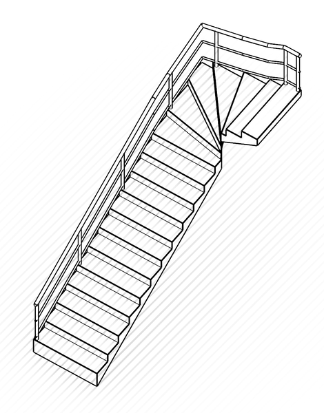
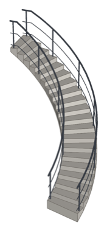
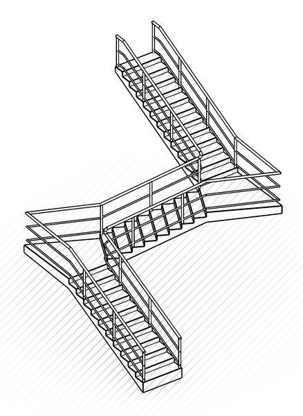
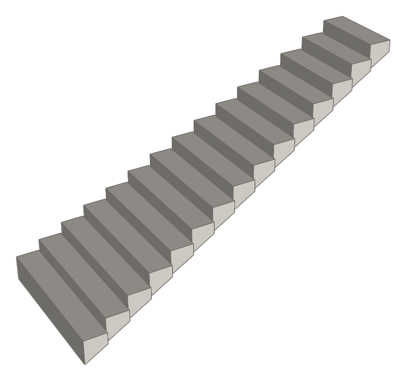
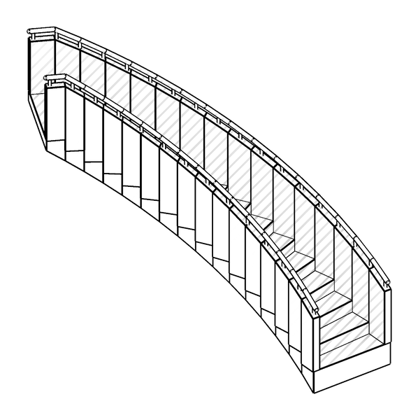
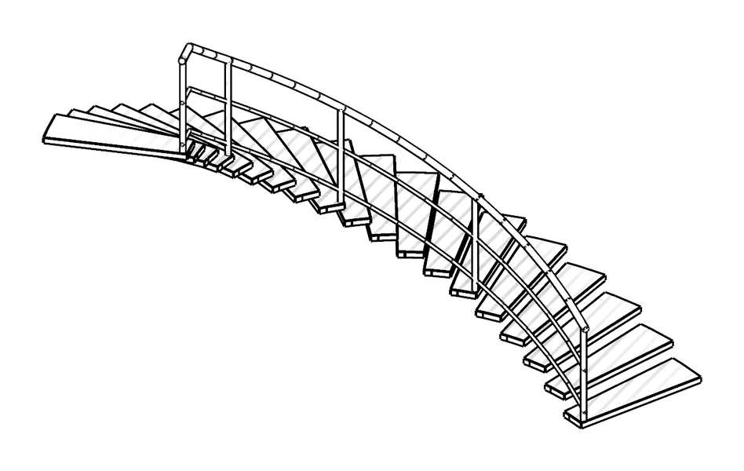

# Stairs for Rhino 8 / 9

**Version 1.4.0**

Draw a curve, set the height, and StairsGen builds the whole staircase: steps,
structure, step numbers and railings, with a live preview.


## Features

- **Any flat curve**: lines, arcs, freeform curves, polylines. The curve can be
  the stair's middle, inner edge or outer edge.
- **Riser and tread, as in Revit.** **Fit to Curve** sizes the treads to fill
  the curve; typing a depth fixes it.
- **Landings at corners** (on by default). The two corners of a U-turn share
  one landing. **Pick Corners…** switches any corner to winders.
- **Winders** that never overlap, at any angle, including tight smooth bends.
- **Sharp or rounded** corners under 60°.
- **Top landing** or **leave unused** when the curve is longer than the stair.
- **Autoconfigure** from the total height alone, by the comfort rule
  (riser + tread ≈ 46 cm / 18").
- **Slab or floating planks**, rest steps anywhere, pyramid (narrowing) width.
- **Railings**: glass, metal, or concrete with balusters.
- **Metric or imperial**: fields read and show any unit (`7in`, `18cm`, `6'-8"`).
- **Follows the curve** while the dialog is open.

| Winders | Curved |
|:---:|:---:|
|  |  |
| **Autoconfigured** | **Pyramid width** |
|  |  |
| **Concrete railings** | **Floating planks** |
|  |  |

## Install

Download `Stairs-<version>.zip` from
[Releases](https://github.com/char-papadopoulos/stairsgen-plugin/releases):

- **macOS:** copy `Stairs.rhp` to
  `~/Library/Application Support/McNeel/Rhinoceros/9.0/MacPlugIns/` (`8.0` for
  Rhino 8) and restart Rhino.
- **Windows:** drag `Stairs.rhp` onto Rhino, or Tools > Options > Plug-ins >
  Install….

## Usage

Run `StairsGen` and click points along the stair (Enter to finish), or use
**SelectCurve** for an existing curve. Adjust the settings, then click
**Create Stairs**.

## Build

Needs the .NET SDK 7 or later.

```bash
cd src/StairsPlugin && dotnet build -c Release
```

Output: `src/StairsPlugin/bin/Release/StairsPlugin.dll`. Rename it to
`Stairs.rhp` to install it.

## Tests

With Rhino running and `StartScriptServer` on:

```bash
tests/run_tests.sh
```

It runs every scenario in metres, millimetres and inches, and checks for valid
solids, treads that tile without gaps or overlaps, and the expected warnings.
`tests/run_tests.sh "" corner` runs only scenarios named with "corner".

## License

[MIT](LICENSE). RhinoCommon (McNeel) and Eto.Forms (BSD-3-Clause) are not
included.
