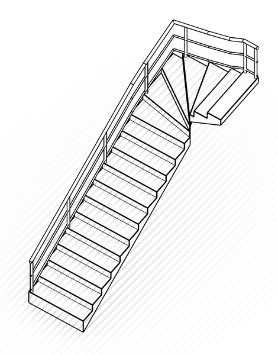
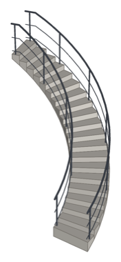
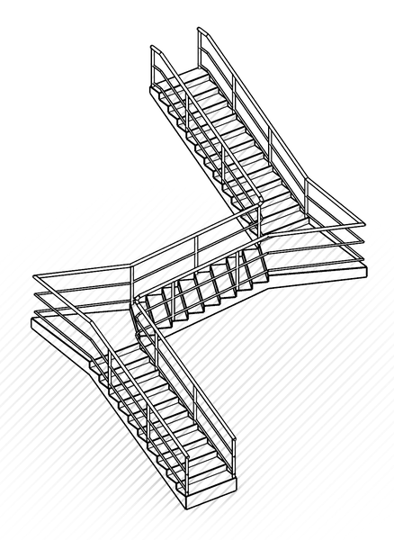
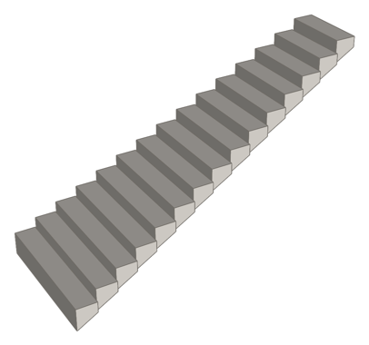

# Stairs for Rhino 8

**Version 1.1.5**

A Rhino 8 plug-in that builds a complete staircase along a flat curve. Draw
the curve, set the total height, and the plug-in lays out the steps, the
structure, the step numbers and the railings, with a live preview while you
adjust it.


## Features

- **Any flat curve.** Straight lines, arcs, freeform curves and polylines
  with sharp corners. The curve can be the stair's mid line, inner edge or
  outer edge.
- **Winders at corners.** A sharp corner becomes a fan of winder treads
  around the inner corner. Treads never overlap or leave gaps, at any angle.
  A smooth bend tighter than the stair is wide gets the same fan, from the
  point where the inside edge of the stair would cross itself.
- **Comfortable steps.** Tread depth follows the comfort rule
  (riser + tread ≈ 46 cm) by default. No tread's average depth goes below
  18 cm, so sharp corners get fewer, wider winders.
- **Autoconfigure.** Give only the total height: it chooses the number of
  steps, sizes the treads so the last step ends exactly at the end of the
  curve, and adds a rest step after every 15 steps. With square corner
  landings on, it also puts a landing in every sharp corner and picks the
  step count whose worst flight comes closest to the comfort rule.
- **Structure.** A continuous concrete-like slab with a sloped underside, or
  floating planks.
- **Rest steps** (landings) at any step, as deep as the stair is wide or
  with a custom depth.
- **Square corner landings** (on by default): a rest step that reaches a
  sharp corner fills the whole corner, with its edges square to the flights
  before and after it instead of following the winders. With fitted treads,
  each flight is fitted to end exactly at its landing. With a fixed tread
  depth, the landing stretches back along the flight to meet the treads.
- **Railings** on either or both sides: glass with a metal frame, a metal
  railing, or a concrete wall that stops 10 cm below the handrail, with 3 cm
  metal balusters at most 30 cm apart filling the gap.
- **Step numbers** placed flat on each tread.
- **Pyramid width.** Each step can be narrower than the one below, snapped
  to the center, the left side or the right side.
- **Draw or select the curve.** Click points to draw the stair's line right
  in the command, or select a curve already in the model.
- **Follows the curve.** Move or edit a selected curve while the settings
  window is open and the stair updates with it.

| Winders | Curved |
|:---:|:---:|
|  |  |
| **Autoconfigured** | **Pyramid width** |
|  |  |

## Requirements

- Rhino 8 (developed and tested on Rhino 8.35, macOS on Apple silicon).
- To build: the .NET SDK 7 or later.

The plug-in targets `net7.0` and references only `RhinoCommon` and
`Eto.Forms`, which Rhino provides at runtime. The build is a single
`StairsPlugin.dll`. It is written to run on Windows as well, but it has only
been tested on macOS.

## Build

```bash
cd src/StairsPlugin
dotnet build -c Release
```

The plug-in is written to `src/StairsPlugin/bin/Release/StairsPlugin.dll`.

## Install

Download `Stairs-<version>.zip` from the
[Releases](https://github.com/char-papadopoulos/stairsgen-plugin/releases) page and
follow the `INSTALL.txt` inside. In short:

- **macOS:** copy `Stairs.rhp` into
  `~/Library/Application Support/McNeel/Rhinoceros/8.0/MacPlugIns/`, then restart
  Rhino.
- **Windows:** keep `Stairs.rhp` in a permanent folder and drag it onto the Rhino
  window, or use Tools > Options > Plug-ins > Install….

Rhino only loads a new build of the plug-in at startup, so restart it after every
update. `_PlugInManager` should list Stairs as loaded.

To install your own build instead, copy the built DLL with the `.rhp` extension, for
example on macOS:

```bash
cp src/StairsPlugin/bin/Release/StairsPlugin.dll "$HOME/Library/Application Support/McNeel/Rhinoceros/8.0/MacPlugIns/Stairs.rhp"
```

## Usage

Run the `StairsGen` command and click points along the stair: each click adds a
corner of a polyline, Enter finishes it and **Undo** removes the last point.
Every point is kept at the first one's height. To use a flat curve already in
the model instead, choose the **SelectCurve** option, or select the curve before
running the command; the stair then follows that curve while the settings
window is open. The settings window opens, and the preview updates in every
viewport as you change a setting.

## Development

- `src/StairsPlugin/Core` holds the geometry. It is pure RhinoCommon with no
  document access.
  - `StairLayout` lays out the steps, the corner zones and the tread depths.
  - `StairGeometry` builds treads, slabs and step numbers.
  - `RailBuilder` builds the railings.
- `src/StairsPlugin/UI` holds the settings dialog and the preview display.

### Regression tests

The tests run inside a running Rhino through its script server
(`StartScriptServer` in Rhino, plus the `rhinocode` CLI that ships with it):

```bash
tests/run_tests.sh
```

This builds the Debug DLL, runs `tests/test_geometry.py` in Rhino, prints
PASS or FAIL per scenario, and exits non-zero on any failure. It adds nothing
to the open document. Two variants:

- `tests/run_tests.sh path/to/Some.dll` tests another build.
- `tests/run_tests.sh "" corner` runs only scenarios whose name contains
  "corner".

The suite builds each scenario three times: in metres with a 1 mm and with a
1 cm tolerance, and in millimetres. It covers
straight lines, arcs (left, right, beyond 180°), freeform curves, polylines
with 60°, 90°, 135° and 160° corners for every curve role, U-turns, rest
steps, flip, every depth mode, Autoconfigure, pyramid widths, all railing types
and the overflow warning. For each scenario it checks that:

- slabs, planks and railings are valid closed solids or valid breps;
- treads tile the stair without overlaps or gaps;
- no tread's average depth is below 18 cm;
- the depth rule holds (comfort rule, custom depth, or fitted to the curve
  end);
- pyramid steps have the right width and stay snapped to the chosen side;
- only the expected warnings appear.

`rhinocode script` silently ignores script paths that contain a space, so
`run_tests.sh` runs a copy of the test script from `/tmp`.

## License

StairsGen is released under the [MIT License](LICENSE). It runs on RhinoCommon,
which Rhino provides under McNeel's own terms, and uses Eto.Forms (BSD-3-Clause)
for its dialog; neither is included in this repository.
